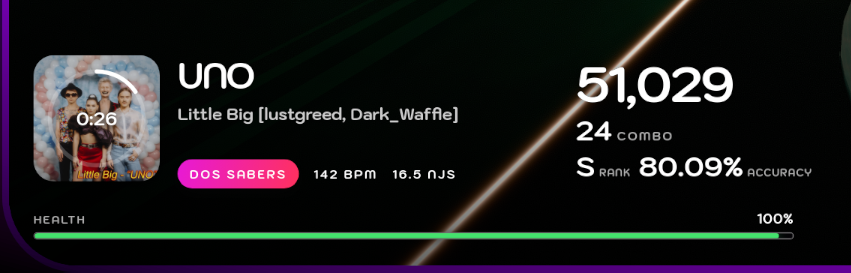
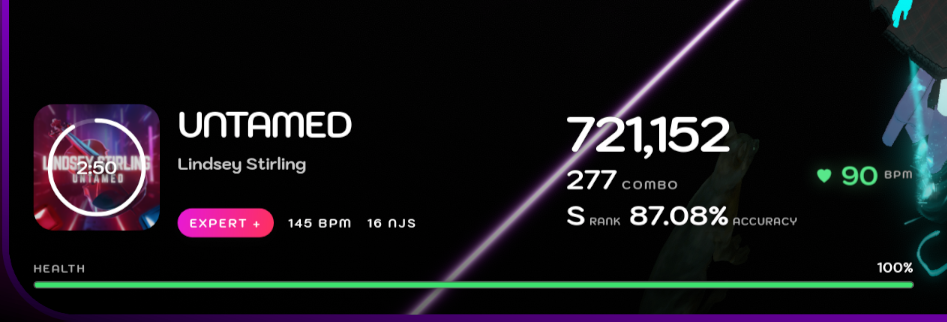

  

# BS Stream Overlay

**Launch the overlay:** [https://bs-overlay.thetimevortex.net](https://bs-overlay.thetimevortex.net)

BS Stream Overlay is an open-source, customizable Beat Saber browser overlay powered by [DataPuller](https://github.com/WentTheFox/BSDataPuller) or [Beat Saber Plus](https://github.com/hardcpp/BeatSaberPlus)'s Song Overlay module (BS+ SO). It can display live song and performance information, including cover art, song title, difficulty, BPM, NJS, BSR code, score, combo, rank, accuracy, misses, and health. Optional gameplay indicators show when a song is paused or No Fail has triggered, and rank letters can use the UITweaks color palette. A heart-rate readout can use [HRCounter](https://github.com/qe201020335/HRCounter), Pulsoid BRO plan, or free HypeRate as its provider, and appear with the song overlay or as a separately positioned element.

## Preview

### Song and performance details

### With heart rate

## Gameplay indicators

The **Gameplay indicators** section offers three optional settings, all off by default:

- **Paused indicator:** displays a pause icon over the cover art in place of the elapsed-time label while a song is paused. Supports DataPuller and BS+ SO. With DataPuller, it also detects when playback stops advancing for 2.5 seconds after the song has started progressing, while both telemetry connections are active.
- **No Fail indicator:** keeps the overlay visible after failing with the No Fail modifier enabled and adds a red **NF** ribbon to the cover. The overlay still hides when the song finishes or is quit. This option is **DataPuller only**; it is disabled for BS+ SO because that source does not provide the required No Fail trigger data. Switching back to DataPuller restores your saved preference.
- **Colored ranks:** colors the rank letter using the UITweaks palette: **SSS/SS** cyan, **S** green, **A** yellow, **B** orange, **C** orange-red, and **D/E** red. Supports both data sources.

The pause icon and NF ribbon require cover art to be enabled. These settings are saved locally and included in copied overlay URLs as `paused=1`, `nofail=1`, and `rankcolors=1`, respectively. **Load settings** restores them from an existing URL. Generated BS+ SO URLs omit `nofail=1`, and that parameter has no effect while using BS+ SO.

### Visual refinements

Cover images and their shading follow the cover's rounded corners. In light mode, hovering over the URL box uses a translucent highlight that preserves the header's accent gradient instead of covering it with solid gray.

## Heart Rate

Enable **Show heart rate** in the settings panel and choose [HRCounter](https://github.com/qe201020335/HRCounter), Pulsoid, or HypeRate as the provider. You can display it in either of two ways:

- **With song overlay** attaches the heart icon and current heart rate to the main song and performance panel.
- **On its own** separates the heart-rate readout from the song panel and lets you place it in the top-left, top-right, bottom-left, or bottom-right corner.

The heart icon pulses at the reported rate and changes color as your heart rate rises:

- **120 BPM or lower:** green (`#58e88a`)
- **121–149 BPM:** gradually changes from green to yellow
- **150 BPM:** yellow (`#ffd34d`)
- **151–179 BPM:** gradually changes from yellow to red
- **180 BPM or higher:** red (`#ff4860`)

For **HRCounter**, install the mod, enable its HTTP server, and enter its port in the overlay settings. Alternatively, select **Pulsoid** or **HypeRate** as the primary provider.

**Pulsoid** uses one-click account authorization with the `data:heart_rate:read` scope, and the Pulsoid account connecting to the overlay must have a BRO plan. Select **Pulsoid**, choose **Connect Pulsoid**, approve BS Overlay, and you will return to the settings page automatically.

**HypeRate** only requires the ID shown by your device.

## Requirements

- DataPuller or BS+ SO installed and enabled in Beat Saber
- HRCounter with its HTTP server enabled, a Pulsoid BRO plan account, or a public HypeRate ID
- Streaming software that supports browser sources, such as OBS Studio, Streamlabs Desktop, Meld Studio, or similar software

## Font selection compatibility

Chromium-based browsers, such as Google Chrome, Microsoft Edge, Brave, or Opera/OperaGX, can request access to locally installed system fonts and show them in the font picker. Browsers without local font-list access, including Firefox, show a curated selection of free Google Fonts instead; you can also enter the exact family name of an installed font and press Enter to use it.

## Create your overlay

1. Install [DataPuller](https://github.com/WentTheFox/BSDataPuller) or [Beat Saber Plus](https://github.com/hardcpp/BeatSaberPlus) in Beat Saber. If using BS+, enable its Song Overlay module.
2. Start Beat Saber and make sure your selected data provider is running.
3. Open [bs-overlay.thetimevortex.net](https://bs-overlay.thetimevortex.net).
4. The overlay automatically uses the available provider. If both are detected, choose **DataPuller** or **BS+ SO** in the connection card, then configure the overlay position and information you want to display. Enabling only one provider is recommended for best performance.
5. Enable **Show heart rate**, choose **With song overlay** or **On its own**, then select and configure HRCounter, paid Pulsoid, or free HypeRate as the provider.
6. Select **Copy overlay URL** at the top of the page.
7. Add a browser source in OBS, Streamlabs, Meld, or another supported streaming application.
8. Paste the copied URL into the browser source.

Your selected settings are stored in the generated URL, so the browser source will use the same layout, scale, one-color or two-color accent, corner shadow, gameplay indicators, and visible fields. Two-color accents render as a horizontal gradient from color 1 on the left to color 2 on the right. To edit an existing overlay, select **Load settings** on the settings page and paste its URL.

DataPuller exposes some fields that BS+ SO does not, including NJS and (depending on the map) a BSR key. Unavailable values are shown as a dash or hidden when using BS+.

# Disclaimer
This project was made with the assistance of AI.

## Custom layout editor

Choose **Custom layout** beneath the corner presets to arrange individual overlay elements on a 1920 × 1080 canvas. Select an element by clicking its sidebar row (text or empty space) or clicking it on the canvas. Only the actual switch changes visibility; selecting a row opens custom mode. Click an empty area of the canvas to clear selection. Drag to move it, drag a corner handle to scale it proportionally, and drag the round handle to rotate it. For health, the left/right handles adjust only the bar width and preserve text size; top/bottom and corner handles scale the entire health element. The sidebar also provides exact X/Y coordinates, scale, and rotation. Arrow keys move the selected element by one pixel; hold Shift for ten pixels. **Reset selected element** restores its default transform; **Reset all elements** restores every element’s default position, scale, and rotation without changing visibility settings. Rotation pivots around the element’s center, and corner scaling keeps its center fixed when there is room. Dragging snaps edges and centers to canvas boundaries, canvas center lines, and nearby visible elements, with pink alignment guides. Hold Alt to bypass snapping or use arrow keys for precise nudging. Moving, resizing, rotating, and numeric edits keep the full rotated element within all four canvas edges; oversized elements are scaled to fit.

Cover art, elapsed time (including its progress ring), and the paused/No Fail indicators form one group and share a transform. Selecting any of their sidebar rows selects this group. All other song/performance fields, health, and heart rate have independent transforms. Their existing toggles still control visibility. Unavailable fields have placeholders in the editor only. Colored ranks and corner shadows remain styling options.

The four song-panel corner presets and four independent heart-rate corner positions remain available. Selecting a song-panel preset exits custom mode without discarding custom transforms; selecting Custom layout restores them. Custom mode positions heart rate independently regardless of its preset pairing setting. Custom layouts are saved locally and included in copied URLs; **Load settings** restores them. Browser sources scale the reference canvas proportionally to fit their resolution. Global overlay scale applies to presets; custom elements use their individual scale controls.

### Saved custom presets

Custom layout offers three local preset slots. **Save preset 1**, **2**, or **3** stores the current overlay URL, including appearance, visibility and custom transforms. The slot then becomes **Load preset**; the adjacent trash button clears just that slot so it can be saved again. Loading restores the saved settings immediately. Slots persist across reloads and resetting the current settings, and are stored only in this browser for this site. Use **Copy overlay URL** to share a saved layout with someone else.

### Selecting multiple elements

Drag across an empty area of the custom canvas to select multiple visible elements. Hold Shift while clicking elements or sidebar rows to add or remove them, or Shift-drag to extend a selection. Drag the selection to move it together, and use its round handle or Rotation field to rotate around the group's center. Arrow keys nudge the entire selection; X/Y move its bounds. The group snaps and stays inside the canvas without changing relative spacing or individual scales. Group rotation stops when the selected arrangement cannot fit inside the canvas. Click empty canvas space to deselect. The selected reset button resets all selected elements; individual element resize handles return when only one element is selected.

### Undo and redo

Use **Ctrl+Z** to undo and **Ctrl+Shift+Z** to redo, or use the arrow buttons beside the reset controls. Undo covers layout transforms (including health width and group edits), resets, visibility, appearance changes, and loading settings or saved presets. Each completed drag is one step. Up to 100 edits are kept during the current page session; a new edit clears redo history. Text fields keep their normal text-editing shortcuts, and provider credentials and saved preset slots are unaffected.
